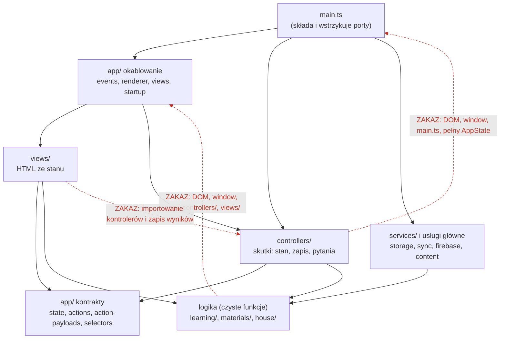
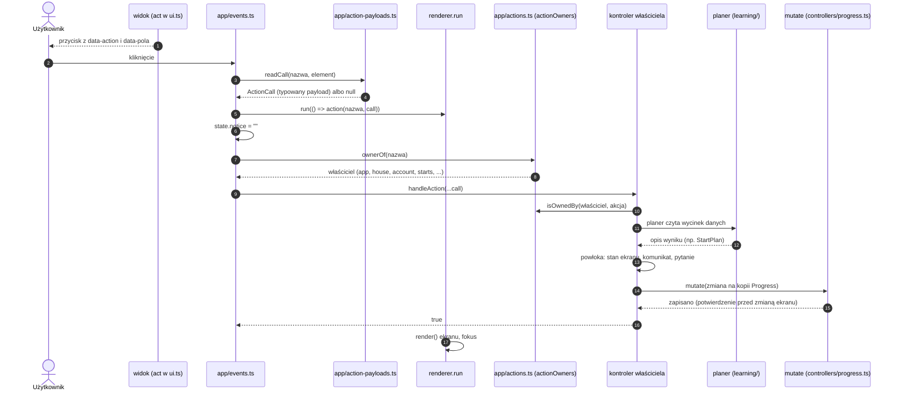
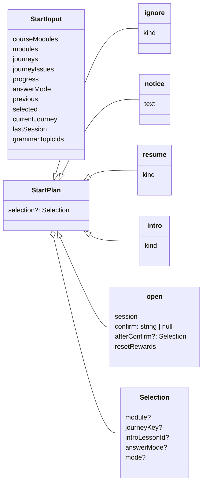
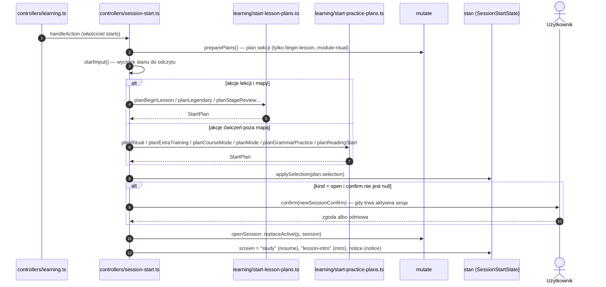
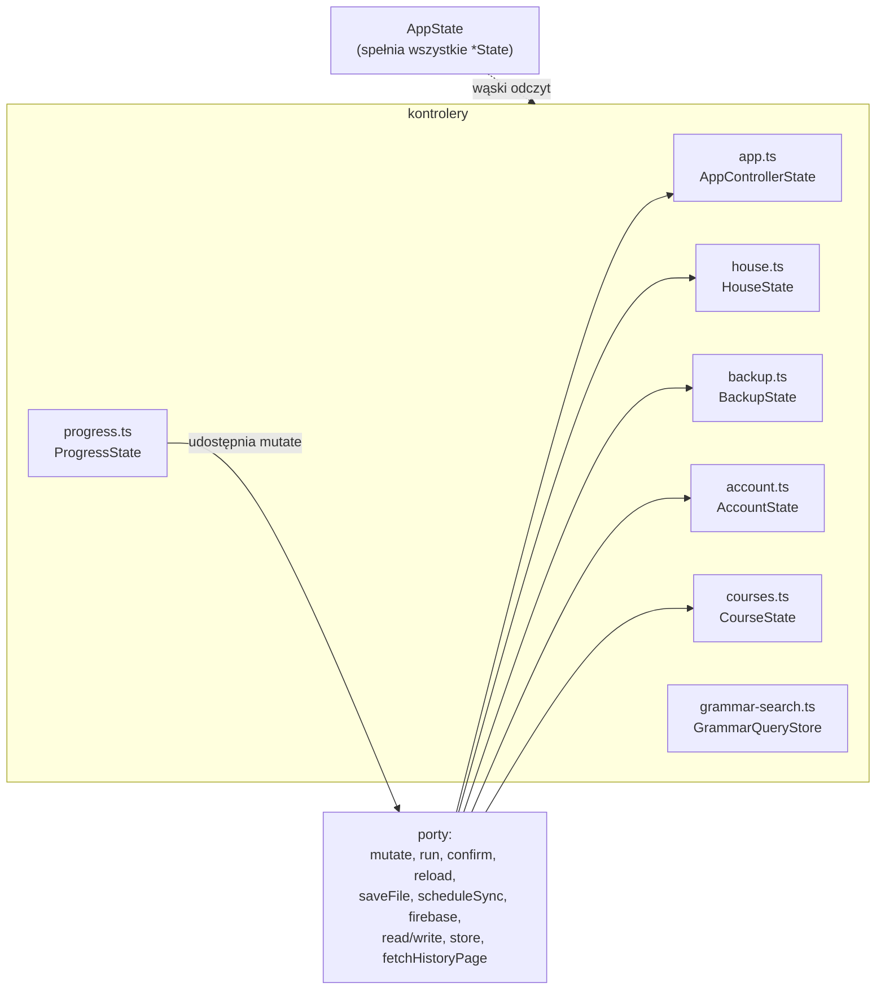
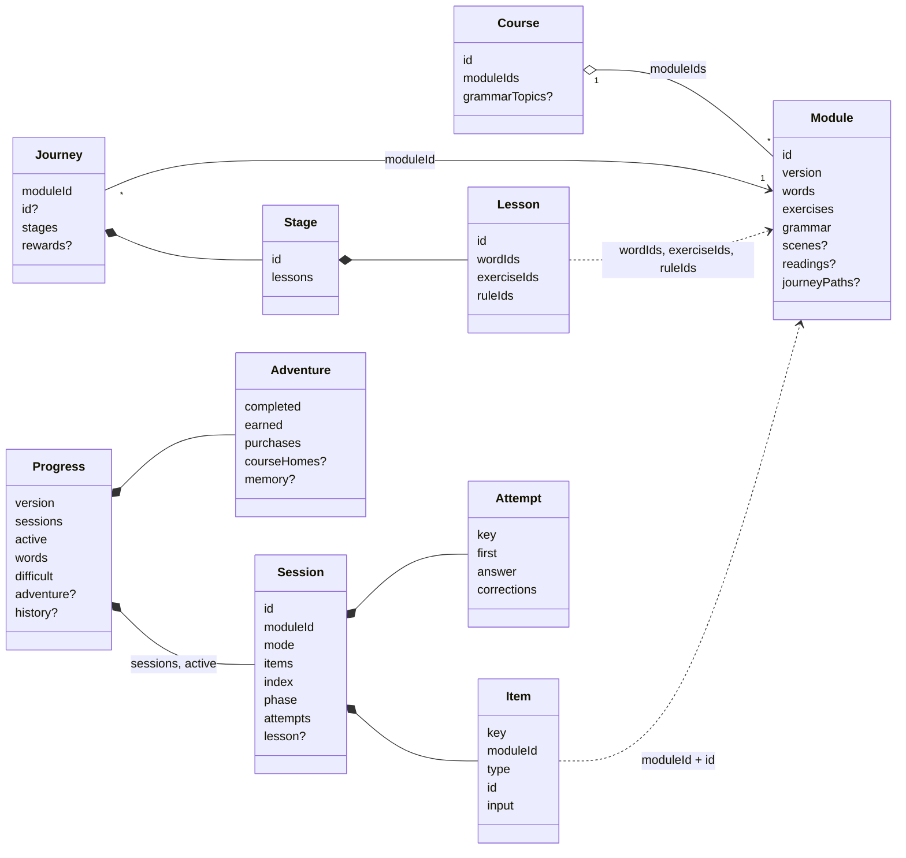
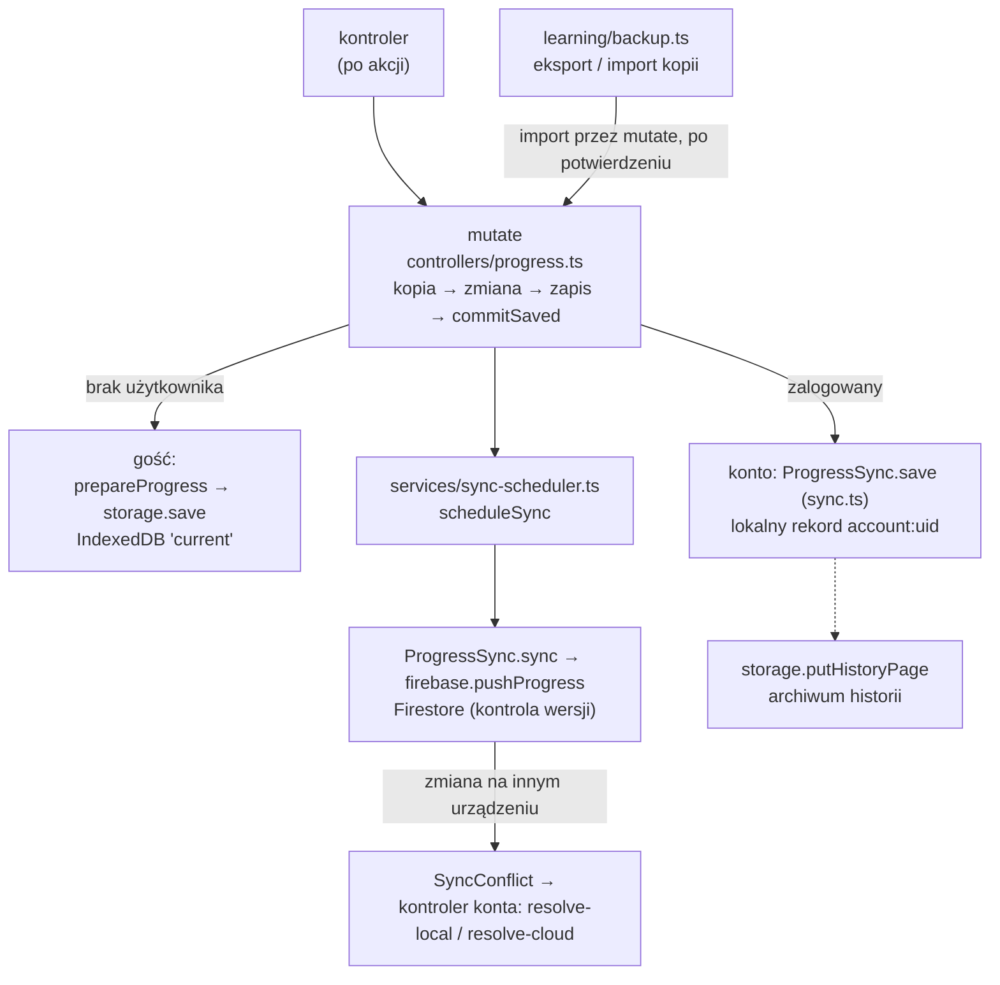
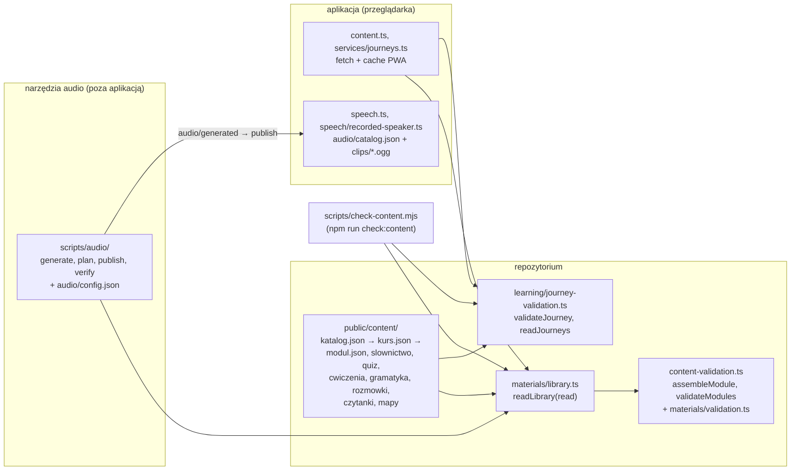

# Diagramy architektury

Obraz stanu kodu w `src/` — uzupełnia [architekturę](05-architektura.md) (tam jest „gdzie co leży” i zasady), [zasady kodu](zasady-kodu.md) (dlaczego tak) i [zapis](06-zapis.md) (pola i zgodność). Diagramy są w Mermaid, więc renderują się na GitHubie. Powstały z importów i typów w kodzie, nie z opisów; przy zmianie granic poprawiaj je razem z architekturą. Strzałka `A --> B` znaczy „A importuje B” albo „A wywołuje B”.

Spis: [1 · Warstwy](#1--warstwy-i-kierunek-zależności) · [2 · Przepływ akcji](#2--przepływ-akcji) · [3 · Rozpoczynanie sesji](#3--rozpoczynanie-sesji-d-76) · [4 · Kontrolery i wąskie stany](#4--kontrolery-i-wąskie-stany) · [5 · Model danych i zapis](#5--model-danych-i-zapis) · [6 · Treść i audio](#6--treść-i-audio)

## 1 · Warstwy i kierunek zależności

Katalog `app/` pełni dwie role. **Kontrakty** (`state.ts`, `actions.ts`, `action-payloads.ts`, `selectors.ts`) to typy i czyste selektory, z których korzystają wszystkie warstwy. **Okablowanie** (`events.ts`, `renderer.ts`, `views.ts`, `startup.ts`) łączy ekran z kontrolerami; to jedyne miejsce w `app/`, które importuje `views/` i `controllers/`. Zależności z `main.ts` nie rysuję poza okablowaniem — `main.ts` tylko składa części i wstrzykuje porty.

Co z tego wynika i czego diagram nie pokazuje:

- Widok nie importuje kontrolera: wywołanie akcji idzie przez atrybut `data-action` i `app/events.ts` (diagram 2). Wyniki zmienia wyłącznie `mutate` z `controllers/progress.ts` (diagram 5).
- Kontroler nie zna DOM-u ani `window`: pytanie (`confirm`), przeładowanie (`reload`), zapis i PWA wchodzą jako porty (diagram 4). Zamiast całego `AppState` dostaje własny wąski interfejs `*State`.
- Logika (`learning/`, `materials/`, `house/`) nie używa DOM, `window`, IndexedDB ani Firebase i nie importuje `app/`, `controllers/`, `views/`. Pilnuje tego `tests/refactor-boundaries.test.ts`.
- Pliki w katalogu głównym `src/` nie tworzą jednej warstwy: `storage.ts`, `sync.ts`, `firebase.ts`, `history.ts`, `content.ts`, `pwa.ts`, `speech.ts` to usługi (porty dla kontrolerów), a `answers.ts`, `stage-review.ts`, `polish-count.ts` — dodatkowa logika, z której korzysta `learning/`.
- Importy wewnątrz logiki nie są jednokierunkowe. `learning/` i `materials/` importują się nawzajem (`materials/model.ts` bierze typy `Module` i `Word` z `learning/model.ts`, a `learning/` korzysta z `materials/`), a `learning/` zależy też od `house/` (m.in. `lesson-session.ts` → `house/progress.ts`, `journey-validation.ts` → `house/catalog.ts`) i od typu `HistorySummary` z `history.ts`. To są zależności od typów i katalogów danych, a nie od DOM; nie ma zależności z logiki do `app/`, `controllers/` ani `views/`.
- `services/sync-scheduler.ts` importuje `app/state.ts` (typ stanu do odczytu etykiety zapisu) — jedyna zależność usługi od `app/`.

## 2 · Przepływ akcji

Każde kliknięcie z `data-action` przechodzi tę samą drogę. Akcja `listen` (odsłuchanie) jest wyjątkiem: `speech.handleAction` nie zapisuje i nie rysuje ekranu, więc omija część poniżej (D-58).

- Brak właściciela (`undefined`) albo brak wymaganego pola (`call === null`) oznacza, że nic się nie dzieje. Nieznana nazwa akcji nie skompiluje się w widoku, bo `act()` przyjmuje tylko `AppAction`.
- Nie każda akcja ma planer ani zapis: akcje stanu ekranu (np. `home`, `house-tab`) kończą się na zmianie stanu i renderze. Kroki z planerem i `mutate` dotyczą tylko akcji, które rozstrzyga logika i zapisują postępy.
- Właściciele `navigation`, `starts`, `answers`, `reading` trafiają do jednego kontrolera `learning`, który przekazuje je dalej (diagram 4). Pozostali właściciele (`house`, `backup`, `account`, `app`, `speech`) mają po jednym kontrolerze.

## 3 · Rozpoczynanie sesji (D-76)

Decyzja (co ma się stać) jest w czystych planerach, skutek (pytanie, stan, zapis) w jednej powłoce. Typ wyniku `StartPlan` jest w `learning/start-plan.ts`.

`StartPlan` to unia z polem `kind`: `ignore` (nic), `notice` (komunikat), `resume` (powrót do trwającej sesji), `intro` (ekran wprowadzenia lekcji), `open` (nowa sesja). Poniżej przebieg dla akcji z właścicielem `starts`.

- Planery nie dostają `AppState` ani nie pytają użytkownika; czyta je test planera bez stanu. Powłoka `applyPlan` jako jedyna pyta o zastąpienie aktywnej sesji (`confirmReplacement`).
- `lessonAfterFinished` (akcje `following-lesson`, `legendary` po zakończeniu lekcji) używa `planLessonAfterFinished`, którego wynikiem nie jest `StartPlan`, tylko typ `After` z `start-lesson-plans.ts`.

## 4 · Kontrolery i wąskie stany

Każdy kontroler to fabryka `createXController(state, ports)`. `AppState` spełnia wszystkie poniższe interfejsy strukturalnie (nie przez `implements`), ale kontroler widzi tylko swój. Kontroler nauki składa trzy podkontrolery; jego stan jest sumą ich stanów.

```mermaid
classDiagram
    direction LR
    class AppState
    class JourneyScope
    class SessionStartState
    class AnswerState
    class ReadingState
    class LearningState
    class LearningController { navigation }
    class SessionStartController { starts }
    class SessionAnswerController { answers }
    class ReadingController { reading }

    SessionStartState --|> JourneyScope
    LearningState --|> SessionStartState
    LearningState --|> AnswerState
    LearningState --|> ReadingState
    LearningController ..> LearningState
    SessionStartController ..> SessionStartState
    SessionAnswerController ..> AnswerState
    ReadingController ..> ReadingState
    LearningController *-- SessionStartController
    LearningController *-- SessionAnswerController
    LearningController *-- ReadingController
    AppState ..> LearningState : spełnia strukturalnie
```

Pozostałe kontrolery, ich stany i porty. Porty to wszystko, co leży poza stanem: zapis, sieć, okno przeglądarki. Wstrzykuje je `main.ts` (a `events.ts` dla kontrolerów `app` i `speech`); w testach są atrapami.

| Kontroler | Stan | Najważniejsze porty |
| --- | --- | --- |
| `app.ts` | `AppControllerState` | `confirm`, `installPwa`, `prepareOffline`, `applyUpdate` |
| `house.ts` | `HouseState` | `mutate`, `courseId` |
| `backup.ts` | `BackupState` | `mutate`, `getHistoryPage`, `saveHistoryPage`, `saveFile`, `run` |
| `account.ts` | `AccountState` | `sync`, `scheduleSync`, `firebase`, `confirm`, `isOnline`, `loadGuestProgress`, `storeUser`, `run`… |
| `courses.ts` | `CourseState` | `read`, `write` (wybór kursu w IndexedDB) |
| `progress.ts` | `ProgressState` | `sync`, `store`, `run`, `render`, `scheduleSync`, `isOnline`, `fetchHistoryPage` |
| `learning.ts` | `LearningState` | `mutate`, `reload`, `confirm`, `courses`, `scheduleReviewMigration` |
| `session-start.ts` | `SessionStartState` | `mutate`, `confirm` |
| `session-answers.ts` | `AnswerState` | `mutate`, `courseId` |
| `reading.ts` | `ReadingState` | `mutate` |
| `grammar-search.ts` | `GrammarQueryStore` | — (tylko `grammarQuery`) |
| `speech.ts` | — | — (nie zapisuje) |

## 5 · Model danych i zapis

### Model

Treść (kurs, moduł, mapa) jest wspólna dla kont; postępy (`Progress`) są osobne dla każdego konta. Pola w diagramie są wyborem — komplet jest w `learning/model.ts`, a opis i zasady zgodności w [zapisie](06-zapis.md#słownik-pól). Typ `Course` jest w `materials/model.ts`, a `Module`, `Progress`, `Session`, `Item`, `Attempt` w `learning/model.ts`; `Journey`, `Stage`, `Lesson` w `learning/journey.ts`; `Adventure` w `learning/adventure-state.ts`.

Klucze map (`journeyKey`) i lekcji (`lessonKey`) łączą mapę z zapisem: `Adventure.completed` i `Session.lesson.id` wskazują lekcję tym kluczem, więc nie zmieniamy `id` (D-52).

### Zapis lokalny i synchronizacja

- Stan ekranu (`AppState`) nie jest zapisywany; zapis obejmuje `Progress`, archiwum historii i lokalne preferencje poza postępami ([zapis](06-zapis.md#gdzie-leżą-dane)).
- Wywołania `firebase.ts` idą przez leniwy `services/firebase-client.ts` (`sdk()`); `firebase` jest jedyną zależnością w działaniu.

## 6 · Treść i audio

Treść kursów jest danymi: ta sama funkcja `readLibrary` czyta je w przeglądarce, w testach, w kontroli treści i w generatorze audio. Aplikacja nie importuje niczego ze `scripts/`; generator importuje z `src/` (czytanie biblioteki, klucze pytań, normalizację tekstu), w drugą stronę zależności nie ma.

- Walidacja odrzuca błędny plik z czytelnym komunikatem (moduł: `readLibrary` rzuca błąd; mapa: `readJourneys` izoluje błąd jednej mapy — [odporność map](odpornosc-map.md)).
- Nagrania są plikami statycznymi: `publish.mjs` buduje lekki indeks `audio/catalog.json` i klipy `clips/*.ogg`, a aplikacja pobiera je i odtwarza z zapasem w postaci syntezy i ciszy (`speech.ts`). Szczegóły i kolejność — [generowanie audio](generowanie-audio.md). Nagrania generuje się dopiero po zatwierdzeniu treści.
- Zakres kontroli: `npm run check:content` (treść), `npm run audio:check` (zgodność nagrań z treścią) — [testy](07-testy.md).
